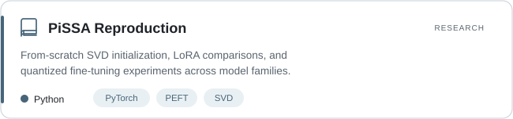

# Hi! I'm Xiangyun 👋

**Artificial Intelligence · Research & Engineering**

· I'm an Artificial Intelligence undergraduate at South China University of Technology, interested in the space between machine learning research and practical implementation.

· My work spans computer vision, OCR, reinforcement learning, and efficient model adaptation, with an emphasis on understanding methods through experiments and code.

---

### Selected Work

<a href="https://github.com/sleepingZzzzz/pissa-reproduction">
  <picture>
    <source media="(prefers-color-scheme: dark)" srcset="assets/pissa-card-dark.svg">
    
  </picture>
</a>
